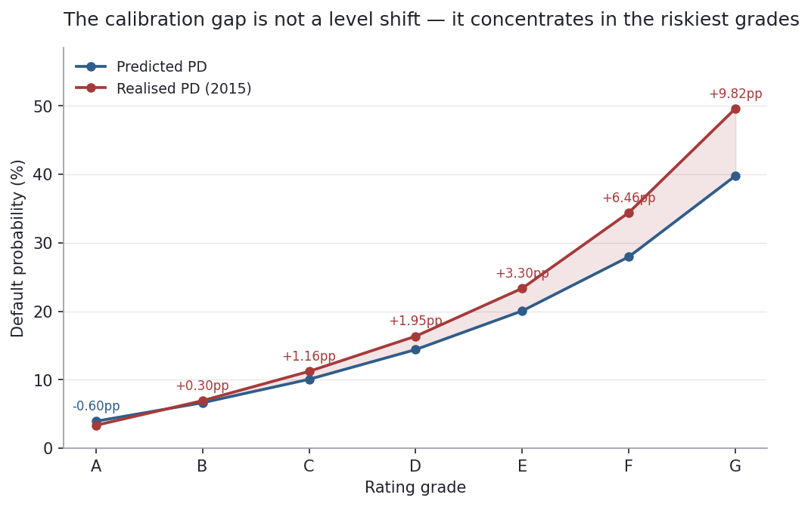
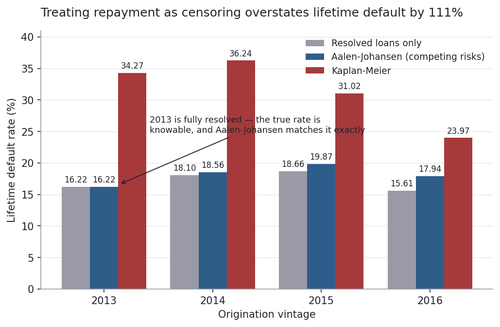
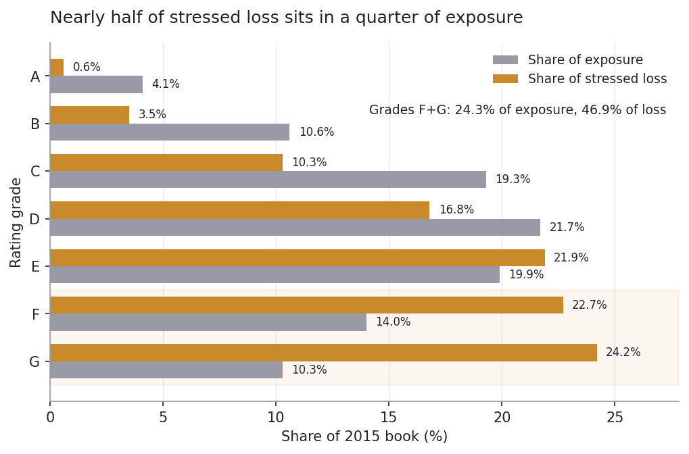

# Credit Risk & PD Engine — Lending Club 2007–2018

An application scorecard, a master rating scale, lifetime PD estimation, and a loss
quantification — built end to end on 2.26M consumer loan originations.

**Full write-up: [WRITEUP.md](WRITEUP.md)**

---

## The finding in 60 seconds

The scorecard predicts a 17.20% default rate for 2015. The realised rate is 20.19%.
On a $5.50bn book at 65% LGD, that three-point miss is **$115m of unexpected loss**.

The obvious explanations both fail. Population Stability Index on the score
distribution is **0.0005** — the applicant pool did not shift. And a competing-risks
survival estimator puts 2015's true lifetime default rate at **19.87%**, so the
observed figure was not inflated by dropping unresolved loans. Decomposing the
change, **95% of it is within-grade**: borrowers the model scored identically
defaulted more often than they used to.

Reaching that conclusion required catching an error most survival analyses of loan
data make silently. Kaplan-Meier puts 2013's lifetime default rate at **34.27%**.
2013 is fully resolved, so the true answer is knowable: **16.22%**. KM overstates by
111% because it treats repayment as censoring, when repayment is a *competing event* —
a repaid loan has not left early, it can never default. The Aalen-Johansen estimator
returns **16.22%**, exact. That validation against ground truth is what makes the
2015 estimate credible.



---

## Results

### Models (train 2007–2014, test 2015, out-of-time)

| Model | Features | Test AUC | Gini | KS |
|---|---|---|---|---|
| WOE logistic scorecard | 10 binned | 0.7076 | 0.4152 | 0.2986 |
| XGBoost | 20 raw | 0.7165 | 0.4330 | 0.3147 |
| XGBoost, no `installment` | 19 raw | 0.7149 | — | — |
| LC `sub_grade` (benchmark) | 1 | 0.7100 | 0.4200 | — |

The scorecard matches Lending Club's proprietary grade using public attributes only.
XGBoost's clean uplift is **+0.0073** — `installment` can leak `int_rate` via the
annuity formula, and ablation shows that channel is worth only 0.0016.

### Rating scale

| Grade | Score | PD band | % of book | Realised PD (2015) |
|---|---|---|---|---|
| A | 572+ | 0–5% | 4.0 | 3.34% |
| B | 558–572 | 5–8% | 10.4 | 6.94% |
| C | 545–558 | 8–12% | 20.2 | 11.22% |
| D | 533–545 | 12–17% | 24.4 | 16.35% |
| E | 520–533 | 17–24% | 20.8 | 23.35% |
| F | 508–520 | 24–33% | 11.8 | 34.41% |
| G | <508 | 33%+ | 8.4 | 49.60% |

Boundaries are anchored to fixed PD bands, not population quantiles, so a grade means
the same thing across time. Monotonic with no inversions, and **0.7007 AUC against LC's
own seven grades at 0.7008** — a dead heat, with a 14.8× default spread against their
9.8×.

### Lifetime PD (competing risks)

| Vintage | Resolved-only | **Aalen-Johansen** | Kaplan-Meier |
|---|---|---|---|
| 2013 | 16.22 | **16.22** | 34.27 |
| 2014 | 18.10 | **18.56** | 36.24 |
| 2015 | 18.66 | **19.87** | 31.02 |
| 2016 | 15.61 | **17.94** | 23.97 |

2013 is the control: fully resolved, so the first column is the truth. Default hazard
peaks at months 12–18 (4.64% marginal), which is why recent vintages understate.



### Loss

| | LGD 50% | LGD 65% | LGD 80% |
|---|---|---|---|
| EL at model PD | $493m | $641m | $789m |
| EL at realised PD | $582m | $757m | $931m |
| **Unexpected loss** | **$89m** | **$115m** | **$142m** |

LGD is assumed — there is no recovery data in this dataset. Grades F and G are
**24.3% of exposure and 46.9% of stressed loss**.



### Validation

| Check | Result |
|---|---|
| Score PSI (train → test) | 0.0005 |
| Worst characteristic PSI | 0.0581 (`dti_bin`) |
| Top decile lift | 2.37× |
| Defaults in worst 20% | 40.6% |
| Walk-forward AUC | 0.671 → 0.669 → 0.689 → 0.708 |

---

## Two numbers worth putting together

Gradient boosting buys **+0.0073** AUC over the scorecard. Collapsing the scorecard's
continuous PD into seven letter grades costs **−0.0069**.

The entire advantage of the more powerful model class is about the same size as what
the last step of the deployment pipeline throws away. (Sub-grading to 35 buckets
recovers 0.0066 of it.)

---

## What the data killed

| Hypothesis | Killed by |
|---|---|
| The 2015 gap is population drift | PSI 0.0005; mix effect +0.14pp of +3.16pp |
| The observed rate is inflated by censoring | AJ lifetime PD 19.87% vs observed 20.19% |
| Kaplan-Meier is fine for loan survival | 34.27% against a known 16.22% |
| The uplift is `int_rate` leaking via `installment` | Ablation costs 0.0016 of 0.0089 |
| A parallel PD shock is an adequate stress | Shaped shock 7.4% worse on the increment |

---

## Data and split

Lending Club accepted loans 2007–2018Q4 (`accepted_2007_to_2018Q4.csv.gz`, 2.26M rows,
via Kaggle). Target: `Charged Off`, `Default`, and the `Does not meet the credit
policy` variant. Resolved pool 1,348,099 loans.

| Set | Vintages | Loans | Bad rate |
|---|---|---|---|
| Train | 2007–2014 | 453,780 | 0.1703 |
| Test | 2015 | 375,546 | 0.2019 |

Out-of-time, not random — loans from the same month share macro conditions and
underwriting policy, so random holdout leaks. 2016–2018 are excluded from
classification (resolution too low to label) but re-enter as **1.37M censored
observations** in the survival model.

---

## Repo

```
credit-pd-engine/
├── 01_setup_and_data.ipynb          vintage resolution, target, split
├── 02_features_and_woe.ipynb        WOE/IV binning and selection
├── 03_scorecard.ipynb               logistic regression, points, LC benchmark
├── 04_xgboost_benchmark.ipynb       GBM, SHAP, installment ablation
├── 05_validation.ipynb              PSI, gains/lift, walk-forward
├── 06_survival.ipynb                KM, Aalen-Johansen, Cox
├── 07_rating_system.ipynb           PD-anchored grades, head-to-head vs LC
├── 08_stress_and_sensitivity.ipynb  EAD, scenarios, loss concentration
├── data/
│   ├── raw/        accepted_2007_to_2018Q4.csv.gz  (not in repo)
│   └── processed/  cached frames, points table, master scale, scenarios
├── figures/
│   ├── make_figures.py              regenerates the three charts below
│   ├── fig1_lifetime_pd.png
│   ├── fig2_calibration_by_grade.png
│   └── fig3_loss_concentration.png
├── requirements.txt
├── WRITEUP.md
└── README.md
```

```bash
python -m venv .venv
.venv\Scripts\activate
pip install -r requirements.txt
```

Stack: `pandas`, `numpy`, `scikit-learn`, `xgboost`, `lifelines`, `statsmodels`,
`shap`, `matplotlib`. Run notebooks in order from the repo root — 01 and 02 write the
cached frames the rest read. `python figures/make_figures.py` regenerates the charts.

---

## Caveats

Single lender, single credit cycle; no macro sensitivities are estimated because they
could not be identified from this data. LGD is assumed. Survival exit type is
reconstructed from payment dates rather than observed, and runs on a 14% stratified
sample. The Cox C-index (0.6363) is not comparable to the scorecard AUC — it was fit
treating repayment as censoring, the error corrected elsewhere. Full discussion in
[WRITEUP.md](WRITEUP.md#7-limitations).
